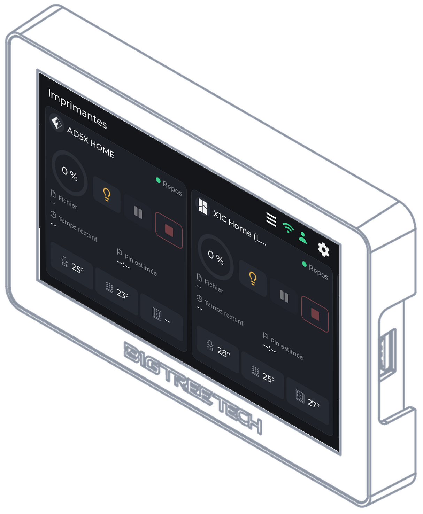
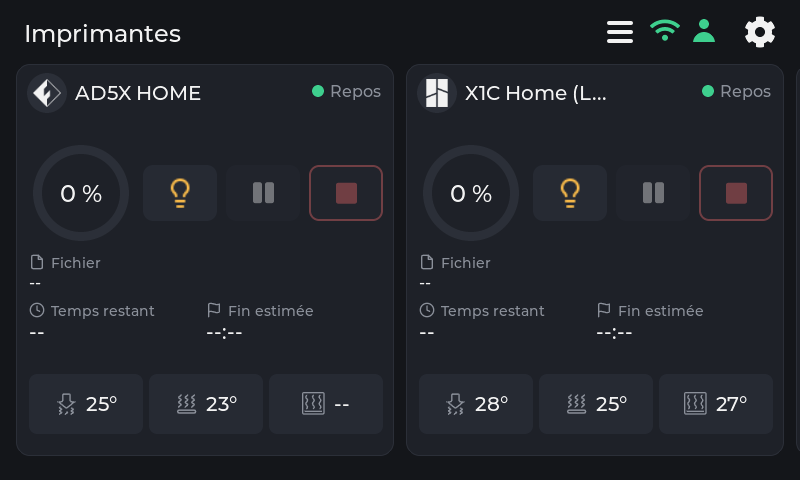
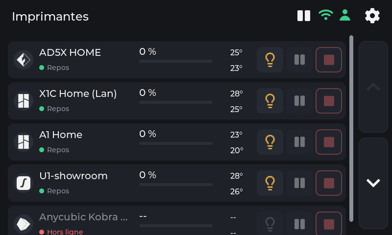
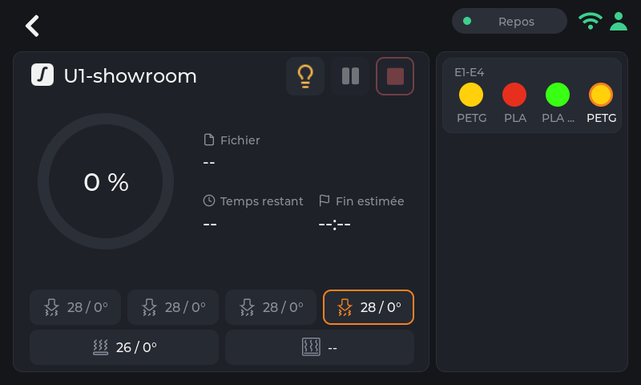
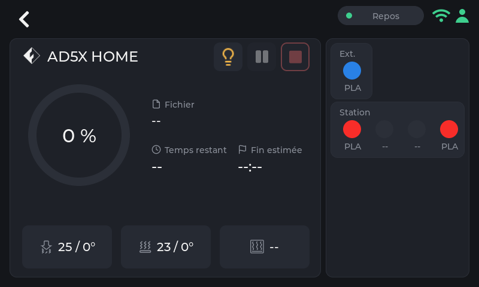
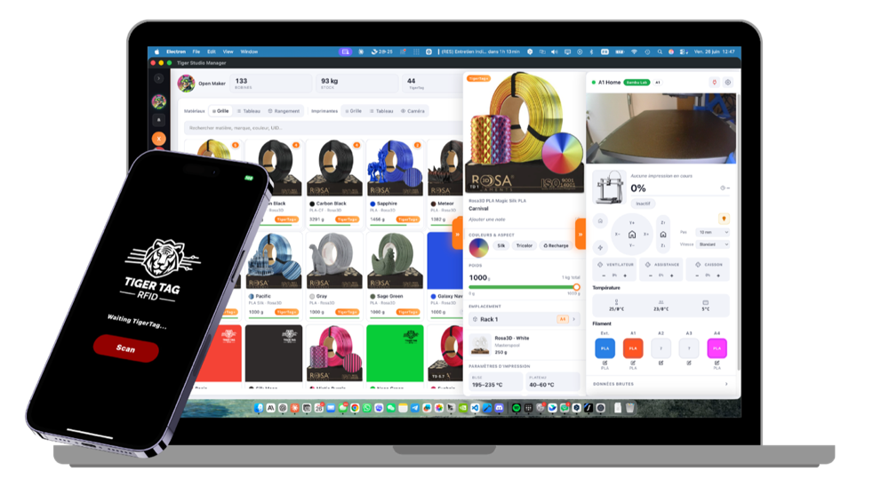
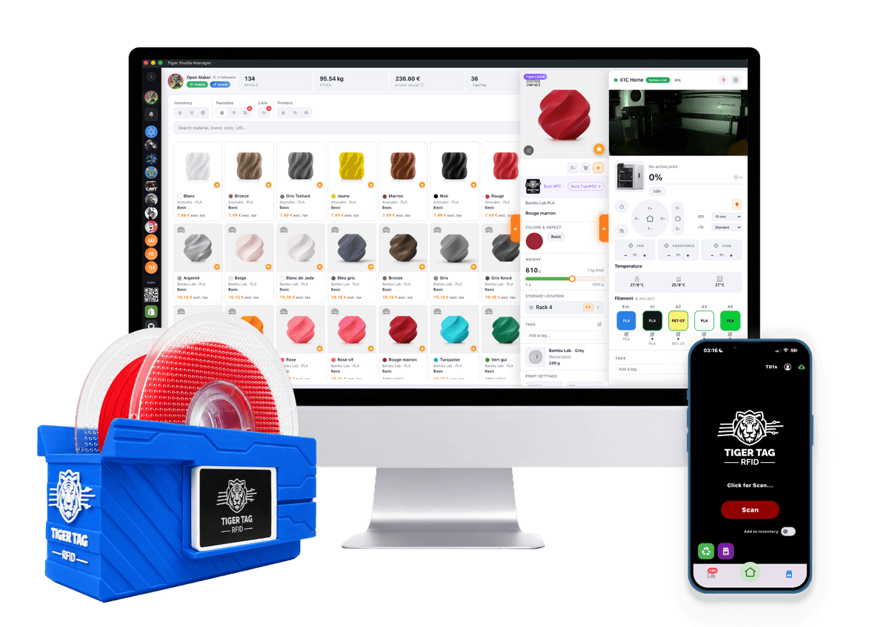

<p align="center">
  <picture>
    <source media="(prefers-color-scheme: dark)"  srcset="assets/logo-tigertag-head-dark.svg">
    <source media="(prefers-color-scheme: light)" srcset="assets/logo-tigertag-head.svg">
    
  </picture>
</p>

<h1 align="center">Tiger Touch</h1>

<p align="center">
  <strong>Your Panda Touch is in a drawer. Give it every printer you own.</strong><br>
  A free, open-source firmware that turns the BIGTREETECH Panda Touch and K-Touch<br>
  into one live touchscreen for Bambu Lab, Creality, Elegoo, Anycubic, Snapmaker,<br>
  FlashForge, Prusa, and any Klipper or OctoPrint 3D printer. No soldering, no computer.
</p>

<p align="center">
  
  
  
  
  
  
</p>

<p align="center">
  
</p>

<p align="center">
  <a href="https://tigertag-project.github.io/Tiger-Touch/">
    
  </a>
</p>

<p align="center">
  <a href="#why-tiger-touch">Why</a>
  &nbsp;&middot;&nbsp;
  <a href="#screens">Screens</a>
  &nbsp;&middot;&nbsp;
  <a href="#printers">Printers</a>
  &nbsp;&middot;&nbsp;
  <a href="#install-in-two-minutes">Install</a>
  &nbsp;&middot;&nbsp;
  <a href="#questions">Questions</a>
  &nbsp;&middot;&nbsp;
  <a href="#build-it-yourself">Build it yourself</a>
</p>

---

## A second life for the screen in your drawer

BIGTREETECH sells one little 5" touchscreen under two names: the **Panda Touch**,
made for Bambu Lab printers, and the **K-Touch**, made for Klipper printers. Same
board, two firmwares, each tied to one family of machines. Change printer, and
the screen goes into a drawer.

**Tiger Touch is a new firmware for that same screen**, written from scratch. It
signs in to your free TigerTag account, finds every printer you declared there,
and talks to each one directly, over its own protocol, at the same time. The
Panda Touch becomes a Bambu Lab touchscreen *and* an Elegoo touchscreen *and* an
Anycubic, Creality, Snapmaker, FlashForge and Prusa touchscreen, all at once.
Your K-Touch keeps showing your Klipper printers, and the Bambu Lab next to them.

Nothing to solder, nothing to print, no Raspberry Pi, no computer left on, no
server in between: you plug the screen into a USB port, press **Install** in your
browser, and two minutes later it shows your printers.

> **Upcycling, not e-waste.** If you own a Panda Touch or a K-Touch that no
> longer matches your printers, it is the hardware Tiger Touch was made for.

## Why Tiger Touch

| | |
|---|---|
| 🖨️ **Every brand on one screen** | Bambu Lab, Creality, Elegoo, Anycubic, Snapmaker, FlashForge, Prusa, plus any Klipper (Moonraker) or OctoPrint machine. Tiger Studio's printer catalogue lists close to 400 models from about 60 makers. |
| ☁️ **Cloud and LAN** | Bambu Lab through the **Bambu cloud** or in LAN mode; Anycubic through the **Anycubic cloud**; the others on your local network. |
| 🔌 **Plug and play** | Printers come from your TigerTag account, with their addresses and access codes. Nothing to type on the screen but your Wi-Fi. |
| 📊 **Live, all of them** | State, progress, file, time left and end time, nozzles, bed, chamber, filament units (AMS, CFS, Station, ACE, MMU / AFC lanes), up to ten printers followed at once. |
| ✋ **Safe controls** | Pause, resume, stop (a 1.5 s hold, so a stray finger never ends a print) and the printer's light. Nothing else is ever sent: no heating, no moving. |
| 🔄 **Updates itself** | New versions arrive over Wi-Fi, verified before install, rolled back by themselves if they fail to start. |
| 🌍 **Eleven languages** | English, French, German, Spanish, Italian, Chinese, Portuguese (Brazil and Portugal), Polish, Russian, Dutch. |
| 💸 **Free and open source** | MIT licensed. No subscription, no account fee, no cloud of ours between you and your printers. |

## Screens

<table>
  <tr>
    <td width="50%"></td>
    <td width="50%"></td>
  </tr>
  <tr>
    <td><b>Cards</b>: one live card per printer, slide for more.</td>
    <td><b>List</b>: every printer at a glance. One touch switches view.</td>
  </tr>
  <tr>
    <td></td>
    <td></td>
  </tr>
  <tr>
    <td><b>Snapmaker U1</b>: four tool heads, the active one ringed.</td>
    <td><b>FlashForge AD5X</b>: external spool and material station.</td>
  </tr>
</table>

## Printers

Tiger Touch picks the connection from the brand, not the model: any printer of
these families that Tiger Studio can add, Tiger Touch can show.

| Brand | Connection | Seen on a real machine |
|---|---|---|
| **Bambu Lab** (X1, P1, P2S, A1, H2...) | **Bambu cloud**, or LAN (MQTT over TLS) | **Yes**: printing through the cloud (P2S), idle in LAN mode (X1C, A1) |
| **Creality** (K2, K1, Hi, Ender-3 V4...) | WebSocket on the LAN | **Yes**: printing (K2), idle with its CFS (Ender-3 V4) |
| **Snapmaker** U1 | Moonraker WebSocket | **Yes**: idle, four tool heads |
| **FlashForge** (AD5X, Adventurer 5M, Creator 5) | HTTP on the LAN | **Yes**: idle (AD5X) |
| **Anycubic** (Kobra 3, Kobra X, Kobra S1...) | **Anycubic cloud**, or LAN (MQTT over TLS) | **Yes**: idle through the cloud (Kobra X), with its ACE |
| **Elegoo** Centauri Carbon 1 and 2 | MQTT (CC2), SDCP (CC1) | Not yet |
| **Prusa** (MK4, Core One, XL, MINI) | PrusaLink | Not yet |
| **Klipper**: Voron, Qidi, Sovol, RatRig... | Moonraker HTTP | Against Tiger Studio's test printer only |
| **OctoPrint**: any Marlin printer behind it | OctoPrint REST API | Against Tiger Studio's test printer only |

"Not yet" means written from the maker's protocol and compiled, never run on that
machine: **a report from your printer is the most useful thing you can send.**
Pause, resume and stop work wherever the connection takes commands (not through
the Bambu or Anycubic cloud); the light works everywhere except Prusa, OctoPrint
and the Centauri Carbon 1. Every field and every test:
**[docs/PRINTER-COMPATIBILITY.md](docs/PRINTER-COMPATIBILITY.md)**.

**A printer shows "offline"?** Check its LAN mode first: it is off by default on
Creality, FlashForge and Bambu Lab.

## Install in two minutes

### 1. Declare your printers once, in Tiger Studio Manager

Tiger Touch reads your printers from your **TigerTag account**, so it never asks
for an address or an access code on a 5" screen. Create the account and add your
printers in **[Tiger Studio Manager](https://github.com/TigerTag-Project/TigerTag-Studio-Manager)**,
the free desktop app of the ecosystem (Windows, macOS, Linux): it finds them on
your network.

<p align="center">
  
</p>

### 2. Flash the screen from your browser

1. Open **<https://tigertag-project.github.io/Tiger-Touch/>** in **Chrome or
   Edge** on a computer (WebSerial: not Safari, not Firefox, not a phone).
2. Plug the Panda Touch or K-Touch in with a USB-C cable, press **Install** and
   pick its serial port.
3. Replacing the BIGTREETECH firmware: tick **Erase device**. Updating a Tiger
   Touch over USB: leave it unticked, your Wi-Fi and account are kept.

First time? **[docs/INSTALL.md](docs/INSTALL.md)** covers the USB driver
(required on macOS), keeping a copy of the BIGTREETECH firmware so you can go
back, and the one box to tick.

### 3. Follow the screen

Language, Wi-Fi, then your TigerTag account: e-mail and password, or **Continue
with Google** with a QR code scanned by your phone
([docs/ONBOARDING.md](docs/ONBOARDING.md)). Switch on the printers you want to
follow, and that is it. *Later* is always an answer: the device starts at once
and connects in the background.

### Updates

Nothing to do. The device checks once a day and shows a new version in
*Settings > Update*; two touches install it, verified first, with your Wi-Fi and
account kept ([docs/OTA.md](docs/OTA.md)).

## Questions

**Is Tiger Touch an alternative firmware for the BIGTREETECH Panda Touch?**
Yes. It replaces the stock Panda Touch firmware with a new one that works with
every brand listed above, not only Bambu Lab. You can go back to the
BIGTREETECH firmware at any time ([docs/INSTALL.md](docs/INSTALL.md)).

**Does it run on the BIGTREETECH K-Touch?**
The K-Touch is the same board as the Panda Touch with a Klipper firmware, so the
same Tiger Touch image is meant for it. Tiger Touch has been run on a Panda Touch
only so far: a report from a K-Touch is welcome.

**Can a Panda Touch show an Elegoo, Anycubic, Creality, Snapmaker, FlashForge or Prusa printer?**
With Tiger Touch, yes, side by side with your Bambu Lab printers, and with any
Klipper or OctoPrint machine.

**Does it work with the Bambu Lab cloud? With the Anycubic cloud?**
Yes, both. Bambu Lab printers can be followed through the Bambu cloud or in LAN
mode, Anycubic printers through the Anycubic cloud or on the LAN, using the
sessions your TigerTag account already holds.

**Is it free?** Yes, MIT licensed, with no subscription. The TigerTag account
and Tiger Studio Manager are free too.

**Do I need a computer or a Raspberry Pi running next to it?** No. A computer is
only needed once, to flash the screen from the browser.

**Do I need to open, solder or wire anything?** No. The screen stays exactly as
BIGTREETECH made it.

**Can it start a print or heat my printer?** No, on purpose. It pauses, resumes,
stops (with a hold) and switches the light, nothing else.

## Powered by TigerSystem

Tiger Touch is part of **TigerSystem**, the open ecosystem built around
**TigerTag**, the open-source RFID standard for 3D-printing filament: one
account, one catalogue of printers, cross-brand and cross-platform by design.
That is why one screen can follow a Bambu Lab, an Elegoo and a Klipper printer
at once: the account already knows them all.

<p align="center">
  
</p>

- **[Tiger Studio Manager](https://github.com/TigerTag-Project/TigerTag-Studio-Manager)** - desktop printer and filament manager. **Start here**: the account and the printers are declared there.
- **[TigerSpool RFID](https://github.com/TigerTag-Project/TigerSpool-RFID)** - tap a spool, the filament lands in the right printer slot
- **[Tiger-Scale-V3](https://github.com/TigerTag-Project/Tiger-Scale-V3)** - the connected filament scale
- **[TigerPOD](https://github.com/TigerTag-Project/TigerPOD)** - open desktop NFC reader/writer
- **[TigerTag-RFID-Guide](https://github.com/TigerTag-Project/TigerTag-RFID-Guide)** - the protocol specification and public registry
- **[TigerSystem-Docs](https://github.com/TigerTag-Project/TigerSystem-Docs)** - the ecosystem's source of truth

## The hardware, and thanks to BIGTREETECH

The **BIGTREETECH Panda Touch** and **K-Touch** are designed and made by
**BIGTREETECH** (BIQU): a 5" 800x480 IPS touchscreen around an ESP32-S3 with
8 MB of PSRAM and 16 MB of flash, Wi-Fi, USB-C and a battery. Tiger Touch runs on
it unmodified, and builds on the board support BIGTREETECH published for it
under the MIT license. Thank you to them for making open hardware support
possible. Pins, timings and the details that bite: [docs/HARDWARE.md](docs/HARDWARE.md).

Tiger Touch is an independent project, not made or endorsed by BIGTREETECH,
BIQU, or any printer maker named here.

## Build it yourself

ESP-IDF 5.5 and the screen's USB cable:

```bash
. $IDF_PATH/export.sh
bash scripts/build.sh
bash scripts/flash.sh /dev/ttyUSB0      # COM10 on Windows; keeps Wi-Fi and account
```

Or with no local toolchain, in Espressif's container:

```bash
docker run --rm -v "$PWD":/project -w /project/firmware espressif/idf:release-v5.5 idf.py build
```

`flash.sh` writes each part at its own offset at 115200 baud (the CH340K loses
bytes faster, on some hosts). **Never write a merged image at 0x0**: it covers the
settings area and wipes the saved Wi-Fi and account.

## Documentation

| | |
|---|---|
| [docs/PRINTER-COMPATIBILITY.md](docs/PRINTER-COMPATIBILITY.md) | Every driver, every field, what has been seen on a real machine |
| [docs/INSTALL.md](docs/INSTALL.md) | Replacing the BIGTREETECH firmware, the macOS driver, building and flashing yourself, going back |
| [docs/ONBOARDING.md](docs/ONBOARDING.md) | The first start, screen by screen, and the reminders |
| [docs/ACCOUNT-PAIRING.md](docs/ACCOUNT-PAIRING.md) | E-mail and password, the Google sign-in by QR, and what the device writes to the account |
| [docs/OTA.md](docs/OTA.md) | The flash layout, the update path, what is checked and what is not |
| [docs/ARCHITECTURE.md](docs/ARCHITECTURE.md) | The tasks, the drivers, and why no screen knows which brand is behind it |
| [docs/CONNECTION-BUDGET.md](docs/CONNECTION-BUDGET.md) | How many printers at once, and the measured price of each connection |
| [docs/HARDWARE.md](docs/HARDWARE.md) | The board as this firmware uses it, and how fast it draws |
| [docs/ROADMAP.md](docs/ROADMAP.md) | What is deliberately not done yet, and why |
| [CHANGELOG.md](CHANGELOG.md) | Every version |
| [CLAUDE.md](CLAUDE.md) · [AGENTS.md](AGENTS.md) · [CODEMAP.md](CODEMAP.md) · [llms.txt](llms.txt) | For people and tools working on the code |

## Support the project

TigerSystem is a personal, community open-source project, built and maintained in free time.
Everything stays free; if it saves you a trip to the printer room, you can support it:

- ☕ [Buy Me a Coffee](https://buymeacoffee.com/benoitl)
- ❤️ [Ko-fi](https://ko-fi.com/tigersystemio)
- 💙 [PayPal](https://paypal.me/tigersystemio)

## Contributing

Issues and pull requests are welcome - reports from printers that are "not yet"
in the table above most of all. [CONTRIBUTING.md](CONTRIBUTING.md) has the
conventions; the short version is that `bash scripts/verify.sh` passes before
anything is reported done, and everything committed is in English.

Security reports: [SECURITY.md](SECURITY.md). Credits: [AUTHORS.md](AUTHORS.md).

## License

[MIT](LICENSE) - build it, sell it, fork it.

Third-party components keep their own licenses: [THIRD_PARTY_LICENSES.md](THIRD_PARTY_LICENSES.md).
Brand names and logos belong to their owners and are used only to say which
printers and which screen Tiger Touch works with; "TigerTag" and "Tiger Touch"
are project names, not an endorsement: [TRADEMARK.md](TRADEMARK.md).

<sub>Keywords: Panda Touch firmware, BTT Panda Touch alternative firmware, K-Touch firmware, BIGTREETECH touchscreen, Bambu Lab touchscreen, Bambu cloud, Anycubic cloud, Elegoo Centauri Carbon screen, Creality K2 monitor, Snapmaker U1, FlashForge AD5X, Klipper touchscreen, OctoPrint touchscreen, multi-printer 3D printer dashboard, ESP32-S3, open source, upcycling.</sub>
