<p align="center">
  <picture>
    <source media="(prefers-color-scheme: dark)"  srcset="assets/logo-tigertag-head-dark.svg">
    <source media="(prefers-color-scheme: light)" srcset="assets/logo-tigertag-head.svg">
    
  </picture>
</p>

<h1 align="center">Tiger Touch</h1>

<p align="center">
  <strong>Your Panda Touch is in a drawer. Give it every printer you own.</strong><br>
  A free, open-source firmware that turns the BIGTREETECH Panda Touch and K-Touch<br>
  into one live touchscreen for Bambu Lab, Creality, Elegoo, Anycubic, Snapmaker,<br>
  FlashForge, Prusa, and any Klipper or OctoPrint 3D printer. No soldering, no computer left on.
</p>

<p align="center">
  
  
  
  
  
  
</p>

<p align="center">
  <picture>
    <source media="(prefers-color-scheme: dark)" srcset="assets/brands/brands-white.svg">
    <source media="(prefers-color-scheme: light)" srcset="assets/brands/brands-dark.svg">
    
  </picture>
</p>

<p align="center">
  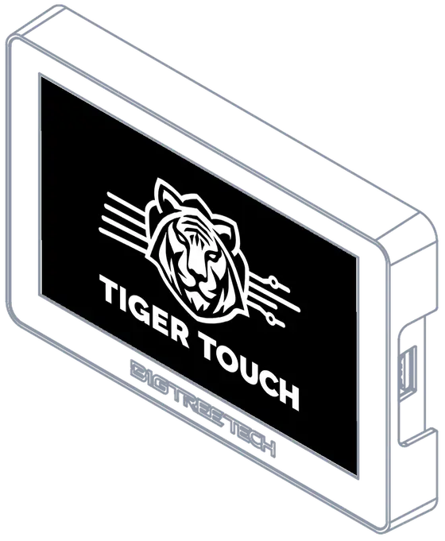
</p>

<p align="center">
  <a href="https://tigertag-project.github.io/Tiger-Touch/">
    
  </a>
</p>

<p align="center">
  <a href="https://tigertag-project.github.io/Tiger-Touch/" hreflang="en">English</a>
  &nbsp;&middot;&nbsp;
  <a href="https://tigertag-project.github.io/Tiger-Touch/fr/" hreflang="fr">Français</a>
  &nbsp;&middot;&nbsp;
  <a href="https://tigertag-project.github.io/Tiger-Touch/de/" hreflang="de">Deutsch</a>
  &nbsp;&middot;&nbsp;
  <a href="https://tigertag-project.github.io/Tiger-Touch/es/" hreflang="es">Español</a>
  &nbsp;&middot;&nbsp;
  <a href="https://tigertag-project.github.io/Tiger-Touch/it/" hreflang="it">Italiano</a>
  &nbsp;&middot;&nbsp;
  <a href="https://tigertag-project.github.io/Tiger-Touch/zh/" hreflang="zh-Hans">中文</a>
  &nbsp;&middot;&nbsp;
  <a href="https://tigertag-project.github.io/Tiger-Touch/pt/" hreflang="pt-BR">Português (BR)</a>
  &nbsp;&middot;&nbsp;
  <a href="https://tigertag-project.github.io/Tiger-Touch/pt-pt/" hreflang="pt-PT">Português (PT)</a>
  &nbsp;&middot;&nbsp;
  <a href="https://tigertag-project.github.io/Tiger-Touch/pl/" hreflang="pl">Polski</a>
  &nbsp;&middot;&nbsp;
  <a href="https://tigertag-project.github.io/Tiger-Touch/ru/" hreflang="ru">Русский</a>
  &nbsp;&middot;&nbsp;
  <a href="https://tigertag-project.github.io/Tiger-Touch/nl/" hreflang="nl">Nederlands</a>
</p>

<p align="center">
  <a href="#why-tiger-touch">Why</a>
  &nbsp;&middot;&nbsp;
  <a href="#screens">Screens</a>
  &nbsp;&middot;&nbsp;
  <a href="#printers">Printers</a>
  &nbsp;&middot;&nbsp;
  <a href="#one-screen-every-brand-tiger-touch-vs-the-stock-firmwares">Compare</a>
  &nbsp;&middot;&nbsp;
  <a href="#install-in-a-few-minutes">Install</a>
  &nbsp;&middot;&nbsp;
  <a href="#questions">Questions</a>
  &nbsp;&middot;&nbsp;
  <a href="#build-it-yourself">Build it yourself</a>
  &nbsp;&middot;&nbsp;
  <a href="#powered-by-tigersystem">TigerSystem</a>
  &nbsp;&middot;&nbsp;
  <a href="#media-kit---press">Media kit</a>
</p>

---

## A second life for the screen in your drawer

BIGTREETECH sells one little 5" touchscreen under two names: the **Panda Touch**,
made for Bambu Lab printers, and the **K-Touch**, made for Klipper printers. Same
board, two firmwares, each tied to one family of machines. Change printer, and
the screen goes into a drawer.

**Tiger Touch is a new firmware for that same screen**, written from scratch. It
signs in to your free TigerSystem account, finds every printer you declared there,
and talks to each one directly, over its own protocol, at the same time. The
Panda Touch becomes a Bambu Lab touchscreen *and* an Elegoo touchscreen *and* an
Anycubic, Creality, Snapmaker, FlashForge and Prusa touchscreen, all at once.
Your K-Touch keeps showing your Klipper printers, and the Bambu Lab next to them.

Nothing to solder, nothing to print, no Raspberry Pi, no computer left on, no
server in between: you plug the screen into a USB port, press **Install** in your
browser, and a few minutes later it shows your printers.

> **Upcycling, not e-waste.** If you own a Panda Touch or a K-Touch that no
> longer matches your printers, it is the hardware Tiger Touch was made for.

## Built around makers, not around a brand

Printer makers build their software around their own machines: their apps,
their clouds and their screens are designed to keep you with their printers.
**TigerSystem starts from the other end: you, the maker.** Whatever printers you
own, whatever their brand, whatever computer or phone you use, our tools adapt
to the way you work, not the other way round.

- **Maker-centric**: one account, one screen, every printer, with the best
  interface we can build for each of them.
- **Open and cross-platform**: each brand's own protocol, on Windows, macOS,
  Linux and your phone, with nothing locked in.
- **No friction, no cost**: free and open source, on a screen you may already
  have in a drawer.

## Why Tiger Touch

| | |
|---|---|
|  **Every brand on one screen** | Bambu Lab, Creality, Elegoo, Anycubic, Snapmaker, FlashForge, Prusa, plus any Klipper (Moonraker) or OctoPrint machine. Tiger Studio's printer catalogue lists close to 400 models from about 60 makers. |
|  **Cloud and LAN** | Bambu Lab through the **Bambu cloud** or in LAN mode; Anycubic through the **Anycubic cloud**; the others on your local network. |
|  **Plug and play** | Printers come from your TigerSystem account, with their addresses and access codes. Nothing to type on the screen but your Wi-Fi. |
|  **Live, all of them** | State, progress, file, time left and end time, nozzles, bed, chamber, filament units (AMS, CFS, Station, ACE, MMU / AFC lanes), up to ten printers followed at once. |
|  **Safe controls** | Pause, resume, stop (it asks for a confirmation first, so a stray finger never ends a print) and the printer's light. Nothing else is ever sent: no heating, no moving. |
|  **Updates itself** | New versions arrive over Wi-Fi, verified before install, rolled back by themselves if they fail to start. |
|  **Eleven languages** | English, French, German, Spanish, Italian, Chinese, Portuguese (Brazil and Portugal), Polish, Russian, Dutch. |
|  **Free and open source** | MIT licensed. No subscription, no account fee, no cloud of ours between you and your printers. |

## Screens

<table>
  <tr>
    <td width="50%"></td>
    <td width="50%"></td>
  </tr>
  <tr>
    <td><b>Cards</b>: one live card per printer, slide for more.</td>
    <td><b>List</b>: every printer at a glance. One touch switches view.</td>
  </tr>
  <tr>
    <td></td>
    <td></td>
  </tr>
  <tr>
    <td><b>Snapmaker U1</b>: four tool heads, the active one ringed.</td>
    <td><b>FlashForge AD5X</b>: paused, in orange; external spool and station.</td>
  </tr>
  <tr>
    <td>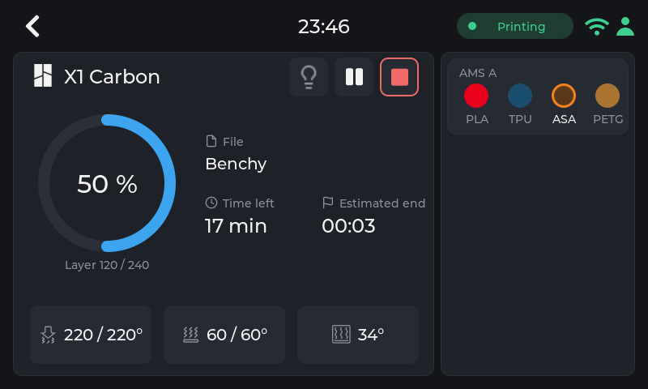</td>
    <td>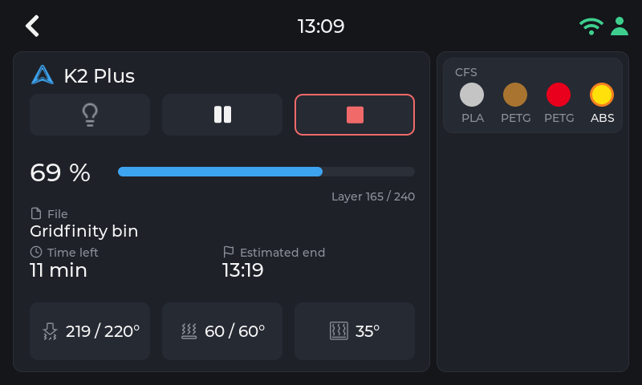</td>
  </tr>
  <tr>
    <td><b>Bambu Lab X1 Carbon</b>: its AMS, the slot in use ringed.</td>
    <td><b>Creality K2 Plus</b>: its CFS, the slot in use ringed.</td>
  </tr>
</table>

<sub>Pictures taken in the screen's <b>Demo mode</b> (<i>Settings > Demo mode</i>), which
shows ten made-up printers of every brand printing, exactly as real ones look:
blue while a print runs, orange when it is paused, green when it is done.</sub>

## Printers

<p align="center">
  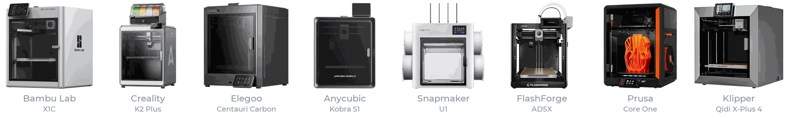
</p>

Tiger Touch picks the connection from the brand, not the model: any printer of
these families that Tiger Studio can add, Tiger Touch can show. Tiger Studio's
catalogue counts about 380 models from about 60 makers.

| Brand | Connection | Seen on a real machine |
|---|---|---|
|  **[Bambu Lab](https://tigertag-project.github.io/Tiger-Touch/bambu-lab/)** (X1, P1, P2S, A1, H2...) | **Bambu cloud**, or LAN (MQTT over TLS) | **Yes**: printing through the cloud (P2S), idle in LAN mode (X1C, A1) |
|  **[Creality](https://tigertag-project.github.io/Tiger-Touch/creality/)** (K2, K1, Hi, Ender-3 V4...) | WebSocket on the LAN | **Yes**: printing (K2), idle with its CFS (Ender-3 V4) |
|  **[Snapmaker](https://tigertag-project.github.io/Tiger-Touch/snapmaker/)** U1 | Moonraker WebSocket | **Yes**: idle, four tool heads |
|  **[FlashForge](https://tigertag-project.github.io/Tiger-Touch/flashforge/)** (AD5X, Adventurer 5M, Creator 5, Creator 5 Pro) | HTTP on the LAN | **Yes**: idle (AD5X) |
|  **[Anycubic](https://tigertag-project.github.io/Tiger-Touch/anycubic/)** (Kobra 3, Kobra X, Kobra S1...) | **Anycubic cloud**, or LAN (MQTT over TLS) | **Yes**: idle through the cloud (Kobra X), with its ACE |
|  **[Elegoo](https://tigertag-project.github.io/Tiger-Touch/elegoo/)** Centauri Carbon 1 and 2 | MQTT (CC2), SDCP (CC1) | Not yet |
|  **[Prusa](https://tigertag-project.github.io/Tiger-Touch/prusa/)** (MK4, Core One, XL, MINI) | PrusaLink | Not yet |
|  **[Klipper](https://tigertag-project.github.io/Tiger-Touch/klipper/)**: Voron, Qidi, Sovol, RatRig... | Moonraker HTTP | Against Tiger Studio's test printer only |
|  **[OctoPrint](https://tigertag-project.github.io/Tiger-Touch/octoprint/)**: any Marlin printer behind it | OctoPrint REST API | Against Tiger Studio's test printer only |

**One page per brand** on the installer site, with what the screen shows for
that brand, its setup and its questions: [Bambu Lab](https://tigertag-project.github.io/Tiger-Touch/bambu-lab/) · [Creality](https://tigertag-project.github.io/Tiger-Touch/creality/) · [Elegoo](https://tigertag-project.github.io/Tiger-Touch/elegoo/) · [Anycubic](https://tigertag-project.github.io/Tiger-Touch/anycubic/) · [Snapmaker](https://tigertag-project.github.io/Tiger-Touch/snapmaker/) · [FlashForge](https://tigertag-project.github.io/Tiger-Touch/flashforge/) · [Prusa](https://tigertag-project.github.io/Tiger-Touch/prusa/) · [Klipper](https://tigertag-project.github.io/Tiger-Touch/klipper/) · [OctoPrint](https://tigertag-project.github.io/Tiger-Touch/octoprint/).

Every page in the installer's eleven languages, each at its own address:

| Language | Pages |
|---|---|
| **[English](https://tigertag-project.github.io/Tiger-Touch/)** | [Bambu Lab](https://tigertag-project.github.io/Tiger-Touch/bambu-lab/) · [Creality](https://tigertag-project.github.io/Tiger-Touch/creality/) · [Elegoo](https://tigertag-project.github.io/Tiger-Touch/elegoo/) · [Anycubic](https://tigertag-project.github.io/Tiger-Touch/anycubic/) · [Snapmaker](https://tigertag-project.github.io/Tiger-Touch/snapmaker/) · [FlashForge](https://tigertag-project.github.io/Tiger-Touch/flashforge/) · [Prusa](https://tigertag-project.github.io/Tiger-Touch/prusa/) · [Klipper](https://tigertag-project.github.io/Tiger-Touch/klipper/) · [OctoPrint](https://tigertag-project.github.io/Tiger-Touch/octoprint/) |
| **[Français](https://tigertag-project.github.io/Tiger-Touch/fr/)** | [Bambu Lab](https://tigertag-project.github.io/Tiger-Touch/fr/bambu-lab/) · [Creality](https://tigertag-project.github.io/Tiger-Touch/fr/creality/) · [Elegoo](https://tigertag-project.github.io/Tiger-Touch/fr/elegoo/) · [Anycubic](https://tigertag-project.github.io/Tiger-Touch/fr/anycubic/) · [Snapmaker](https://tigertag-project.github.io/Tiger-Touch/fr/snapmaker/) · [FlashForge](https://tigertag-project.github.io/Tiger-Touch/fr/flashforge/) · [Prusa](https://tigertag-project.github.io/Tiger-Touch/fr/prusa/) · [Klipper](https://tigertag-project.github.io/Tiger-Touch/fr/klipper/) · [OctoPrint](https://tigertag-project.github.io/Tiger-Touch/fr/octoprint/) |
| **[Deutsch](https://tigertag-project.github.io/Tiger-Touch/de/)** | [Bambu Lab](https://tigertag-project.github.io/Tiger-Touch/de/bambu-lab/) · [Creality](https://tigertag-project.github.io/Tiger-Touch/de/creality/) · [Elegoo](https://tigertag-project.github.io/Tiger-Touch/de/elegoo/) · [Anycubic](https://tigertag-project.github.io/Tiger-Touch/de/anycubic/) · [Snapmaker](https://tigertag-project.github.io/Tiger-Touch/de/snapmaker/) · [FlashForge](https://tigertag-project.github.io/Tiger-Touch/de/flashforge/) · [Prusa](https://tigertag-project.github.io/Tiger-Touch/de/prusa/) · [Klipper](https://tigertag-project.github.io/Tiger-Touch/de/klipper/) · [OctoPrint](https://tigertag-project.github.io/Tiger-Touch/de/octoprint/) |
| **[Español](https://tigertag-project.github.io/Tiger-Touch/es/)** | [Bambu Lab](https://tigertag-project.github.io/Tiger-Touch/es/bambu-lab/) · [Creality](https://tigertag-project.github.io/Tiger-Touch/es/creality/) · [Elegoo](https://tigertag-project.github.io/Tiger-Touch/es/elegoo/) · [Anycubic](https://tigertag-project.github.io/Tiger-Touch/es/anycubic/) · [Snapmaker](https://tigertag-project.github.io/Tiger-Touch/es/snapmaker/) · [FlashForge](https://tigertag-project.github.io/Tiger-Touch/es/flashforge/) · [Prusa](https://tigertag-project.github.io/Tiger-Touch/es/prusa/) · [Klipper](https://tigertag-project.github.io/Tiger-Touch/es/klipper/) · [OctoPrint](https://tigertag-project.github.io/Tiger-Touch/es/octoprint/) |
| **[Italiano](https://tigertag-project.github.io/Tiger-Touch/it/)** | [Bambu Lab](https://tigertag-project.github.io/Tiger-Touch/it/bambu-lab/) · [Creality](https://tigertag-project.github.io/Tiger-Touch/it/creality/) · [Elegoo](https://tigertag-project.github.io/Tiger-Touch/it/elegoo/) · [Anycubic](https://tigertag-project.github.io/Tiger-Touch/it/anycubic/) · [Snapmaker](https://tigertag-project.github.io/Tiger-Touch/it/snapmaker/) · [FlashForge](https://tigertag-project.github.io/Tiger-Touch/it/flashforge/) · [Prusa](https://tigertag-project.github.io/Tiger-Touch/it/prusa/) · [Klipper](https://tigertag-project.github.io/Tiger-Touch/it/klipper/) · [OctoPrint](https://tigertag-project.github.io/Tiger-Touch/it/octoprint/) |
| **[中文](https://tigertag-project.github.io/Tiger-Touch/zh/)** | [Bambu Lab](https://tigertag-project.github.io/Tiger-Touch/zh/bambu-lab/) · [Creality](https://tigertag-project.github.io/Tiger-Touch/zh/creality/) · [Elegoo](https://tigertag-project.github.io/Tiger-Touch/zh/elegoo/) · [Anycubic](https://tigertag-project.github.io/Tiger-Touch/zh/anycubic/) · [Snapmaker](https://tigertag-project.github.io/Tiger-Touch/zh/snapmaker/) · [FlashForge](https://tigertag-project.github.io/Tiger-Touch/zh/flashforge/) · [Prusa](https://tigertag-project.github.io/Tiger-Touch/zh/prusa/) · [Klipper](https://tigertag-project.github.io/Tiger-Touch/zh/klipper/) · [OctoPrint](https://tigertag-project.github.io/Tiger-Touch/zh/octoprint/) |
| **[Português (BR)](https://tigertag-project.github.io/Tiger-Touch/pt/)** | [Bambu Lab](https://tigertag-project.github.io/Tiger-Touch/pt/bambu-lab/) · [Creality](https://tigertag-project.github.io/Tiger-Touch/pt/creality/) · [Elegoo](https://tigertag-project.github.io/Tiger-Touch/pt/elegoo/) · [Anycubic](https://tigertag-project.github.io/Tiger-Touch/pt/anycubic/) · [Snapmaker](https://tigertag-project.github.io/Tiger-Touch/pt/snapmaker/) · [FlashForge](https://tigertag-project.github.io/Tiger-Touch/pt/flashforge/) · [Prusa](https://tigertag-project.github.io/Tiger-Touch/pt/prusa/) · [Klipper](https://tigertag-project.github.io/Tiger-Touch/pt/klipper/) · [OctoPrint](https://tigertag-project.github.io/Tiger-Touch/pt/octoprint/) |
| **[Português (PT)](https://tigertag-project.github.io/Tiger-Touch/pt-pt/)** | [Bambu Lab](https://tigertag-project.github.io/Tiger-Touch/pt-pt/bambu-lab/) · [Creality](https://tigertag-project.github.io/Tiger-Touch/pt-pt/creality/) · [Elegoo](https://tigertag-project.github.io/Tiger-Touch/pt-pt/elegoo/) · [Anycubic](https://tigertag-project.github.io/Tiger-Touch/pt-pt/anycubic/) · [Snapmaker](https://tigertag-project.github.io/Tiger-Touch/pt-pt/snapmaker/) · [FlashForge](https://tigertag-project.github.io/Tiger-Touch/pt-pt/flashforge/) · [Prusa](https://tigertag-project.github.io/Tiger-Touch/pt-pt/prusa/) · [Klipper](https://tigertag-project.github.io/Tiger-Touch/pt-pt/klipper/) · [OctoPrint](https://tigertag-project.github.io/Tiger-Touch/pt-pt/octoprint/) |
| **[Polski](https://tigertag-project.github.io/Tiger-Touch/pl/)** | [Bambu Lab](https://tigertag-project.github.io/Tiger-Touch/pl/bambu-lab/) · [Creality](https://tigertag-project.github.io/Tiger-Touch/pl/creality/) · [Elegoo](https://tigertag-project.github.io/Tiger-Touch/pl/elegoo/) · [Anycubic](https://tigertag-project.github.io/Tiger-Touch/pl/anycubic/) · [Snapmaker](https://tigertag-project.github.io/Tiger-Touch/pl/snapmaker/) · [FlashForge](https://tigertag-project.github.io/Tiger-Touch/pl/flashforge/) · [Prusa](https://tigertag-project.github.io/Tiger-Touch/pl/prusa/) · [Klipper](https://tigertag-project.github.io/Tiger-Touch/pl/klipper/) · [OctoPrint](https://tigertag-project.github.io/Tiger-Touch/pl/octoprint/) |
| **[Русский](https://tigertag-project.github.io/Tiger-Touch/ru/)** | [Bambu Lab](https://tigertag-project.github.io/Tiger-Touch/ru/bambu-lab/) · [Creality](https://tigertag-project.github.io/Tiger-Touch/ru/creality/) · [Elegoo](https://tigertag-project.github.io/Tiger-Touch/ru/elegoo/) · [Anycubic](https://tigertag-project.github.io/Tiger-Touch/ru/anycubic/) · [Snapmaker](https://tigertag-project.github.io/Tiger-Touch/ru/snapmaker/) · [FlashForge](https://tigertag-project.github.io/Tiger-Touch/ru/flashforge/) · [Prusa](https://tigertag-project.github.io/Tiger-Touch/ru/prusa/) · [Klipper](https://tigertag-project.github.io/Tiger-Touch/ru/klipper/) · [OctoPrint](https://tigertag-project.github.io/Tiger-Touch/ru/octoprint/) |
| **[Nederlands](https://tigertag-project.github.io/Tiger-Touch/nl/)** | [Bambu Lab](https://tigertag-project.github.io/Tiger-Touch/nl/bambu-lab/) · [Creality](https://tigertag-project.github.io/Tiger-Touch/nl/creality/) · [Elegoo](https://tigertag-project.github.io/Tiger-Touch/nl/elegoo/) · [Anycubic](https://tigertag-project.github.io/Tiger-Touch/nl/anycubic/) · [Snapmaker](https://tigertag-project.github.io/Tiger-Touch/nl/snapmaker/) · [FlashForge](https://tigertag-project.github.io/Tiger-Touch/nl/flashforge/) · [Prusa](https://tigertag-project.github.io/Tiger-Touch/nl/prusa/) · [Klipper](https://tigertag-project.github.io/Tiger-Touch/nl/klipper/) · [OctoPrint](https://tigertag-project.github.io/Tiger-Touch/nl/octoprint/) |

"Not yet" means written from the maker's protocol and compiled, never run on that
machine: **a report from your printer is the most useful thing you can send.**
Pause, resume and stop work wherever the connection takes commands (not through
the Bambu or Anycubic cloud); the light works everywhere except Prusa, OctoPrint
and the Centauri Carbon 1. Every field and every test:
**[docs/PRINTER-COMPATIBILITY.md](docs/PRINTER-COMPATIBILITY.md)**.

**A printer shows "offline"?** Check its LAN mode first: it is off by default on
Creality, FlashForge and Bambu Lab.

## One screen, every brand: Tiger Touch vs. the stock firmwares

Tiger Touch speaks **each maker's own protocol** - Bambu Lab, Creality, Elegoo,
Anycubic, Snapmaker, FlashForge, Prusa - **plus Klipper and OctoPrint**, all on
the same screen, live, at the same time. The firmwares the screen ships with
each know **one** family of printers.

| | **Tiger Touch** | Panda Touch firmware | K-Touch firmware |
|---|:---:|:---:|:---:|
| **Printer families on one screen** | **9** | 1 (Bambu Lab) | 1 (Klipper) |
| **Printers live at once** | **up to 10**, all updating together | several Bambu Lab, slows down from about 3 in our use | **1** at a time (50 saved, switch between them) |
|  **[Bambu Lab](https://tigertag-project.github.io/Tiger-Touch/bambu-lab/)**: LAN and Bambu cloud |  |  |  |
|  **[Anycubic](https://tigertag-project.github.io/Tiger-Touch/anycubic/)**: Anycubic cloud and LAN |  |  |  |
|  **[Creality](https://tigertag-project.github.io/Tiger-Touch/creality/)** K1 / K2 / Hi / Ender-3 V4 |  |  |  |
|  **[Elegoo](https://tigertag-project.github.io/Tiger-Touch/elegoo/)** Centauri Carbon 1 and 2 |  |  |  |
|  **[Snapmaker](https://tigertag-project.github.io/Tiger-Touch/snapmaker/)** U1 |  |  |  |
|  **[FlashForge](https://tigertag-project.github.io/Tiger-Touch/flashforge/)** AD5X / Adventurer 5M / Creator 5 |  |  |  |
|  **[Prusa](https://tigertag-project.github.io/Tiger-Touch/prusa/)** (PrusaLink) |  |  |  |
|  **[Klipper](https://tigertag-project.github.io/Tiger-Touch/klipper/)** (Moonraker) |  |  |  |
|  **[OctoPrint](https://tigertag-project.github.io/Tiger-Touch/octoprint/)** |  |  |  |
| **Printers set up without typing on the screen** |  from your TigerSystem account |  IP, serial, access code |  IP and port, or a scan |
| **Filament units shown** (AMS, CFS, Station, ACE, MMU / AFC) |  every brand |  AMS | - |
| **Over-the-air updates**: the screen finds new versions and installs them itself, verified, with automatic roll-back |  |  |  |
| **Eleven languages, time zone from your country** |  | - | - |
| **Free and open source (MIT)** |  | - | - |

What each one sends to a printer: Tiger Touch pauses, resumes, stops (after a
confirmation) and switches the light, **and nothing else, on purpose**: a stray
touch on a shared screen never heats, moves or starts anything. BIGTREETECH's
firmwares give full control of their one family (starting prints, temperatures,
moves), and you can go back to them at any time ([docs/INSTALL.md](docs/INSTALL.md)).

| Protocols | Tiger Touch | Panda Touch firmware | K-Touch firmware |
|---|---|---|---|
|  [Bambu Lab](https://tigertag-project.github.io/Tiger-Touch/bambu-lab/) | MQTT over TLS on the LAN (access code), or the Bambu cloud broker | LAN (access code), or Bambu cloud with two-factor sign-in off | - |
|  [Anycubic](https://tigertag-project.github.io/Tiger-Touch/anycubic/) | Anycubic cloud (MQTT, mutual TLS), or MQTT over TLS on the LAN | - | - |
|  [Creality](https://tigertag-project.github.io/Tiger-Touch/creality/) | WebSocket | - | - |
|  [Elegoo](https://tigertag-project.github.io/Tiger-Touch/elegoo/) | MQTT (CC2), SDCP (CC1) | - | - |
|  [Snapmaker](https://tigertag-project.github.io/Tiger-Touch/snapmaker/) | Moonraker WebSocket | - | - |
|  [FlashForge](https://tigertag-project.github.io/Tiger-Touch/flashforge/) | HTTP | - | - |
|  [Prusa](https://tigertag-project.github.io/Tiger-Touch/prusa/) | PrusaLink HTTP | - | - |
|  [Klipper](https://tigertag-project.github.io/Tiger-Touch/klipper/) | Moonraker HTTP | - | Klipper over Wi-Fi (port 7125) |
|  [OctoPrint](https://tigertag-project.github.io/Tiger-Touch/octoprint/) | OctoPrint REST API | - | - |

<sub>Panda Touch and K-Touch: features from BIGTREETECH's wiki
([Panda Touch](https://global.bttwiki.com/PandaTouch.html),
[K-Touch](https://global.bttwiki.com/Klipper%20Touch.html), read 2026-10-16),
which publishes no limit on how many Bambu Lab printers the Panda Touch follows;
"slows down from about 3" is the TigerTag team's own experience with it, not a
BIGTREETECH figure. A dash means the wiki does not say. A tick for Tiger Touch
means supported; which brands have already run on a real machine is in
[Printers](#printers). Tiger Touch's figures
are measured on the board: [docs/CONNECTION-BUDGET.md](docs/CONNECTION-BUDGET.md),
[docs/HARDWARE.md](docs/HARDWARE.md#drawing-speed).</sub>

## Install in a few minutes

### 1. Declare your printers once, in Tiger Studio Manager

Tiger Touch reads your printers from your **TigerSystem account**, so it never asks
for an address or an access code on a 5" screen. Create the account and add your
printers in **[Tiger Studio Manager](https://github.com/TigerTag-Project/TigerTag-Studio-Manager)**,
the free desktop app of the ecosystem (Windows, macOS, Linux): it finds them on
your network.

<p align="center">
  
</p>

### 2. Flash the screen from your browser

1. Open **<https://tigertag-project.github.io/Tiger-Touch/>** in **Chrome or
   Edge** on a computer (WebSerial: not Safari, not Firefox, not a phone).
2. Plug the Panda Touch or K-Touch in with a USB-C cable, press **Install** and
   pick its serial port.
3. Replacing the BIGTREETECH firmware: tick **Erase device**. Updating a Tiger
   Touch over USB: leave it unticked, your Wi-Fi and account are kept.

First time? **[docs/INSTALL.md](docs/INSTALL.md)** covers the USB driver
(required on macOS), keeping a copy of the BIGTREETECH firmware so you can go
back, and the one box to tick.

### 3. Follow the screen

Language, Wi-Fi, then your TigerSystem account: e-mail and password, or **Continue
with Google** with a QR code scanned by your phone
([docs/ONBOARDING.md](docs/ONBOARDING.md)). Switch on the printers you want to
follow, and that is it. *Later* is always an answer: the device starts at once
and connects in the background.

### Updates

Nothing to do. The device checks at start and every six hours and, when a new version is
out, asks on its home screen whether to open the update page (it is also in
*Settings > Update*); two touches install it, verified first, with your Wi-Fi and
account kept ([docs/OTA.md](docs/OTA.md)).

### See it from Tiger Studio

*Settings > Live view* gives Tiger Studio Manager, on the same Wi-Fi, the screen
live: it can show it, touch it and take a screenshot of it for an issue or a
post. Its access code is shown on the screen and written to your TigerSystem
account, where Studio reads it ([docs/LIVE-VIEW.md](docs/LIVE-VIEW.md)).

## Questions

**Is Tiger Touch an alternative firmware for the BIGTREETECH Panda Touch?**
Yes. It replaces the stock Panda Touch firmware with a new one that works with
every brand listed above, not only Bambu Lab. You can go back to the
BIGTREETECH firmware at any time ([docs/INSTALL.md](docs/INSTALL.md)).

**Does it run on the BIGTREETECH K-Touch?**
The K-Touch is the same board as the Panda Touch with a Klipper firmware, so the
same Tiger Touch image is meant for it. Tiger Touch has been run on a Panda Touch
only so far: a report from a K-Touch is welcome.

**Can a Panda Touch show an Elegoo, Anycubic, Creality, Snapmaker, FlashForge or Prusa printer?**
With Tiger Touch, yes, side by side with your Bambu Lab printers, and with any
Klipper or OctoPrint machine.

**Does it work with the Bambu Lab cloud? With the Anycubic cloud?**
Yes, both. Bambu Lab printers can be followed through the Bambu cloud or in LAN
mode, Anycubic printers through the Anycubic cloud or on the LAN, using the
sessions your TigerSystem account already holds.

**Is it free?** Yes, MIT licensed, with no subscription. The TigerSystem account
and Tiger Studio Manager are free too.

**Do I need a computer or a Raspberry Pi running next to it?** No. A computer is
only needed once, to flash the screen from the browser.

**Do I need to open, solder or wire anything?** No. The screen stays exactly as
BIGTREETECH made it.

**Can it start a print or heat my printer?** No, on purpose. It pauses, resumes,
stops (with a hold) and switches the light, nothing else.

## Powered by TigerSystem

Tiger Touch is part of **TigerSystem**, the open ecosystem built around
**TigerTag**, the open-source RFID (NFC) standard for 3D-printing filament: a
small chip on every spool, one free account, and tools that all read the same
inventory and the same printers, whatever their brand. That is why one screen
can follow a Bambu Lab, an Elegoo and a Klipper printer at once: the account
already knows them all.

<p align="center">
  
</p>

<table>
  <tr>
    <td width="50%" align="center">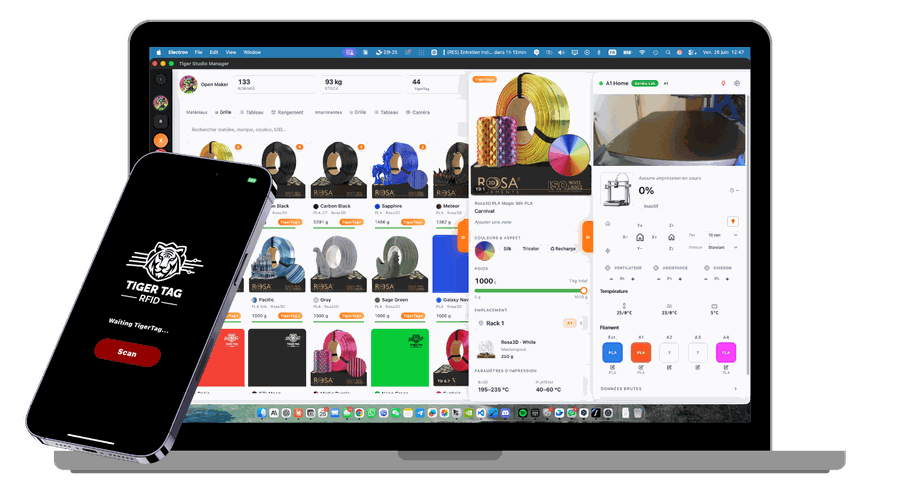</td>
    <td width="50%">
      <b><a href="https://github.com/TigerTag-Project/TigerTag-Studio-Manager">Tiger Studio Manager</a></b> - mission control for your filament and your printers. <b>Start here</b>: the account is created there, and the printers Tiger Touch shows are added with the <b>desktop app</b> (Windows, macOS, Linux), which finds them on your network; the web version cannot add printers.<br><br>
      <b>TigerTag RFID Connect</b> - the iOS and Android app: tap a spool with your phone (NFC) to read it, write a chip, carry your inventory.
      <a href="https://apps.apple.com/app/id6745437963">App Store</a> ·
      <a href="https://play.google.com/store/apps/details?id=com.tigertag.connect">Google Play</a>
    </td>
  </tr>
  <tr>
    <td align="center">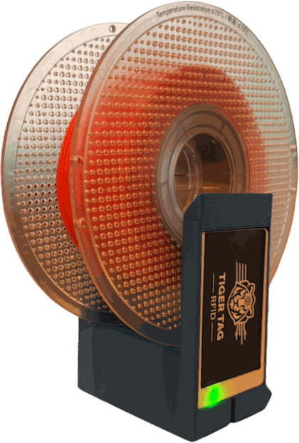</td>
    <td><b><a href="https://github.com/TigerTag-Project/TigerPOD">TigerPOD Mini</a></b> - a spool scanner for your desk that you print yourself: put a spool down and it opens in Tiger Studio; put a blank chip down and it is written. Compact, quick to print, cables routed inside, and it reads and writes TigerTag and OpenSpool chips. <a href="https://makerworld.com/fr/models/3190348-tigerpod-mini-for-openspool-tigertag-rfid-filament">Free on MakerWorld</a>.</td>
  </tr>
  <tr>
    <td align="center">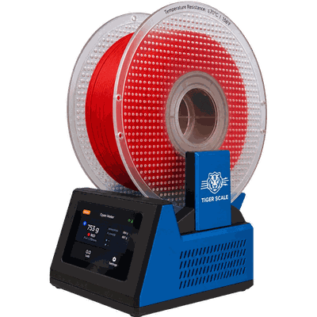</td>
    <td><b><a href="https://github.com/TigerTag-Project/Tiger-Scale-V3">TigerScale V3</a></b> - how much filament is left? Put the spool on this open-source ESP32 scale: the chip says what it is, the load cell says how many grams, and your inventory knows.</td>
  </tr>
  <tr>
    <td align="center">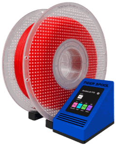</td>
    <td><b><a href="https://github.com/TigerTag-Project/TigerSpool-RFID">TigerSpool</a></b> - a small box beside the printer: pick a slot, hold a spool against it, and the filament is written into that slot, on any brand of printer.</td>
  </tr>
</table>

- **[TigerTag-RFID-Guide](https://github.com/TigerTag-Project/TigerTag-RFID-Guide)** - the open RFID standard: the chip format and the public registry
- **[TigerSystem-Docs](https://github.com/TigerTag-Project/TigerSystem-Docs)** - the whole ecosystem, explained

## The hardware, and thanks to BIGTREETECH

The **BIGTREETECH Panda Touch** and **K-Touch** are designed and made by
**BIGTREETECH** (BIQU): a 5" 800x480 IPS touchscreen around an ESP32-S3 with
8 MB of PSRAM and 16 MB of flash, Wi-Fi, USB-C and a battery. Tiger Touch runs on
it unmodified, and builds on the board support BIGTREETECH published for it
under the MIT license. Thank you to them for making open hardware support
possible. Pins, timings and the details that bite: [docs/HARDWARE.md](docs/HARDWARE.md).

Tiger Touch is an independent project, not made or endorsed by BIGTREETECH,
BIQU, or any printer maker named here.

## Build it yourself

ESP-IDF 5.5 and the screen's USB cable:

```bash
. $IDF_PATH/export.sh
bash scripts/build.sh
bash scripts/flash.sh /dev/ttyUSB0      # COM10 on Windows; keeps Wi-Fi and account
```

Or with no local toolchain, in Espressif's container:

```bash
docker run --rm -v "$PWD":/project -w /project/firmware espressif/idf:release-v5.5 idf.py build
```

`flash.sh` writes each part at its own offset at 115200 baud (the CH340K loses
bytes faster, on some hosts). **Never write a merged image at 0x0**: it covers the
settings area and wipes the saved Wi-Fi and account.

## Documentation

| | |
|---|---|
| [docs/PRINTER-COMPATIBILITY.md](docs/PRINTER-COMPATIBILITY.md) | Every driver, every field, what has been seen on a real machine |
| [docs/INSTALL.md](docs/INSTALL.md) | Replacing the BIGTREETECH firmware, the macOS driver, building and flashing yourself, going back |
| [docs/ONBOARDING.md](docs/ONBOARDING.md) | The first start, screen by screen, and the reminders |
| [docs/ACCOUNT-PAIRING.md](docs/ACCOUNT-PAIRING.md) | E-mail and password, the Google sign-in by QR, and what the device writes to the account |
| [docs/OTA.md](docs/OTA.md) | The flash layout, the update path, what is checked and what is not |
| [docs/LIVE-VIEW.md](docs/LIVE-VIEW.md) | The screen live for Tiger Studio, its access code, screenshots |
| [docs/TELEMETRY.md](docs/TELEMETRY.md) | What the device writes to the account, field by field, and the brief for Tiger Studio |
| [docs/ARCHITECTURE.md](docs/ARCHITECTURE.md) | The tasks, the drivers, and why no screen knows which brand is behind it |
| [docs/CONNECTION-BUDGET.md](docs/CONNECTION-BUDGET.md) | How many printers at once, and the measured price of each connection |
| [docs/HARDWARE.md](docs/HARDWARE.md) | The board as this firmware uses it, and how fast it draws |
| [docs/ROADMAP.md](docs/ROADMAP.md) | What is deliberately not done yet, and why |
| [CHANGELOG.md](CHANGELOG.md) | Every version |
| [CLAUDE.md](CLAUDE.md) · [AGENTS.md](AGENTS.md) · [CODEMAP.md](CODEMAP.md) · [llms.txt](llms.txt) | For people and tools working on the code |

## Support the project

TigerSystem is a personal, community open-source project, built and maintained in free time.
Everything stays free; if it saves you a trip to the printer room, you can support it:

- 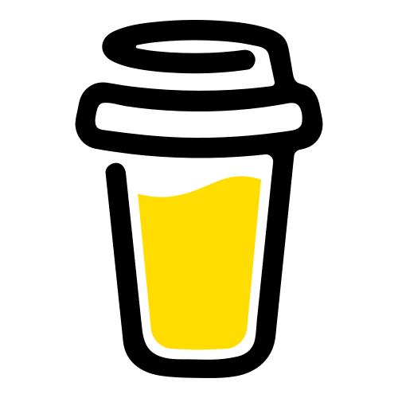 [Buy Me a Coffee](https://buymeacoffee.com/benoitl)
-  [Ko-fi](https://ko-fi.com/tigersystemio)
-  [PayPal](https://paypal.me/tigersystemio)

## Contributing

Issues and pull requests are welcome - reports from printers that are "not yet"
in the table above most of all. [CONTRIBUTING.md](CONTRIBUTING.md) has the
conventions; the short version is that `bash scripts/verify.sh` passes before
anything is reported done, and everything committed is in English.

Security reports: [SECURITY.md](SECURITY.md). Credits: [AUTHORS.md](AUTHORS.md).

## Media kit - Press

Writing about Tiger Touch, making a video or a post? Everything is free to use:
the facts, ready-to-use descriptions, the screen in front view with every capture,
the illustrations and the share pictures.

<p align="center">
  <a href="https://tigertag-project.github.io/Tiger-Touch/press/">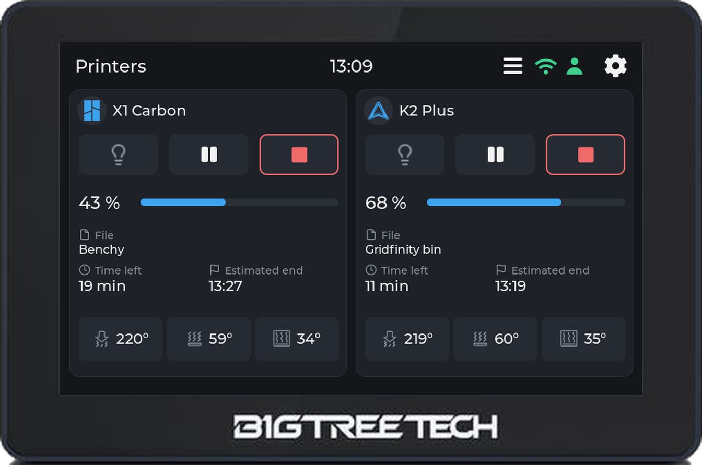</a>
  <a href="https://tigertag-project.github.io/Tiger-Touch/press/">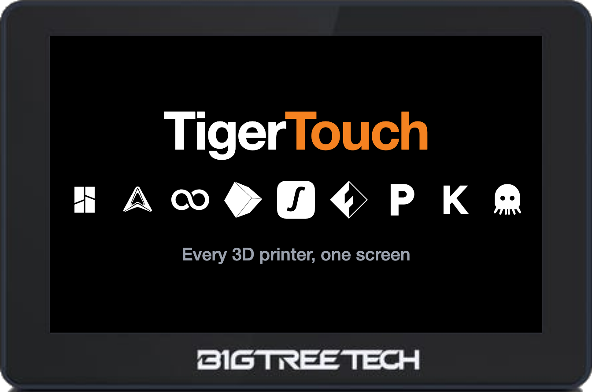</a>
</p>

- **[The media kit page](https://tigertag-project.github.io/Tiger-Touch/press/)**, in the eleven languages, with **[the whole kit as one ZIP](https://tigertag-project.github.io/Tiger-Touch/press/tiger-touch-media-kit.zip)**
- In this repository: [front mockups](assets/mockups/front/) · [screen captures](assets/screens/) · [illustrations](assets/devices/) · [share pictures](assets/og/)
- Questions or an interview: [GitHub issues](https://github.com/TigerTag-Project/Tiger-Touch/issues) or [tigersystem.io](https://tigersystem.io)

The screen pictured is the BIGTREETECH Panda Touch; BIGTREETECH's name and the
printer makers' names and logos belong to their owners ([TRADEMARK.md](TRADEMARK.md)).

## The rest of the TigerSystem family

Tiger Touch is one of TigerSystem's free tools. The others share the same
account, the same spools and the same printers ([more above](#powered-by-tigersystem)):

| | |
|---|---|
|  | **[Tiger Studio Manager](https://github.com/TigerTag-Project/TigerTag-Studio-Manager)** - mission control for your filament and your printers, on Windows, macOS and Linux. Start here: your account and your printers are set up there. |
|  | **[TigerPOD Mini](https://github.com/TigerTag-Project/TigerPOD)** - a spool scanner for your desk that you print yourself: put a spool down and it opens in Tiger Studio. |
|  | **[TigerScale V3](https://github.com/TigerTag-Project/Tiger-Scale-V3)** - an open-source scale: the chip says what the spool is, the load cell how many grams are left. |
|  | **[TigerSpool](https://github.com/TigerTag-Project/TigerSpool-RFID)** - a small box beside the printer: hold a spool against it and the filament is written into the printer's slot. |

Everything at **[tigersystem.io](https://tigersystem.io)**.

## License

[MIT](LICENSE) - build it, sell it, fork it.

Third-party components keep their own licenses: [THIRD_PARTY_LICENSES.md](THIRD_PARTY_LICENSES.md).
Brand names and logos belong to their owners and are used only to say which
printers and which screen Tiger Touch works with; "TigerTag" and "Tiger Touch"
are project names, not an endorsement: [TRADEMARK.md](TRADEMARK.md).

<sub>Keywords: Panda Touch firmware, BTT Panda Touch alternative firmware, K-Touch firmware, BIGTREETECH touchscreen, Bambu Lab touchscreen, Bambu cloud, Anycubic cloud, Elegoo Centauri Carbon screen, Creality K2 monitor, Snapmaker U1, FlashForge AD5X, Klipper touchscreen, OctoPrint touchscreen, multi-printer 3D printer dashboard, ESP32-S3, open source, upcycling.</sub>
