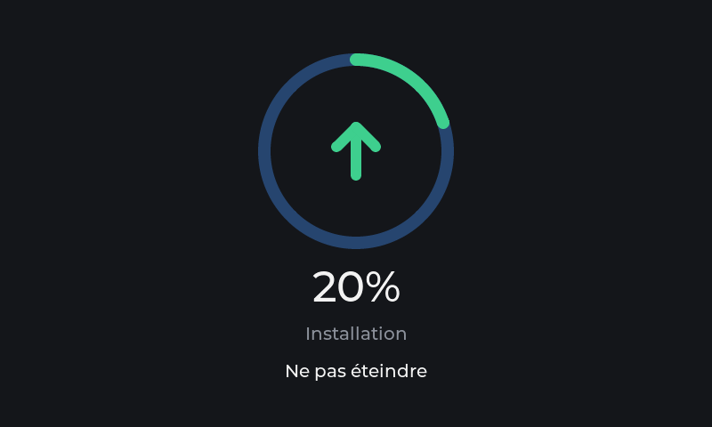

# Over-the-air update

A monitor that sits on a shelf next to the printers has to update itself. Asking
someone to find a cable and a computer for every fix means most units are never
fixed. This is how the Tiger Touch does it, and the decisions that stop being
decisions after the first public release.

## The flash

```
# Name     Type  SubType  Offset     Size       Holds
nvs        data  nvs      0x9000     0x6000     Wi-Fi, account session, choices
otadata    data  ota      0xf000     0x2000     which slot boots, and its state
phy_init   data  phy      0x11000    0x1000     (unused, kept for the layout)
ota_0      app   ota_0    0x20000    0x600000   6 MB
ota_1      app   ota_1    0x620000   0x600000   6 MB
```

16 MB of flash; 12 MB in the two slots, 4 MB left free on purpose (a partition
added later cannot be, so the room is kept rather than spent). The image is about
a third of a slot today.

- **The NVS never moves.** It is at `0x9000` with the size it had in 1.x, so a
  board moved from the single-slot table over USB keeps its Wi-Fi and account,
  and every later version finds it where it left it.
- **The table is frozen from the first public release.** A device cannot rewrite
  its partition table over the air; changing `firmware/partitions.csv` after that
  means every unit is reflashed over USB.
- **The bootloader is never updated over the air** either. The rollback below
  depends on a bootloader option (`CONFIG_BOOTLOADER_APP_ROLLBACK_ENABLE`), so it
  is in the one written over USB, and stays.

## How an update runs

```
 Tiger Touch                               GitHub
     |  GET version.json  (Pages, TLS verified)  |   20 s after start (each minute until
     |                                           |   read), then every 6 h,
     |<-- version, firmware_url, sha256 ---------|   and when the update page opens
     |                                           |
  newer than the running one?  -> a window on the home screen, and Settings
                                  shows it in orange
  "Yes", then a touch on "Install"
     |  GET firmware_url  (release asset, TLS verified, redirects followed)
     |<== streamed into the other slot ==========|
  first block: application name = tiger_touch, version = the one announced
  every block: hashed (SHA-256) and written
  end: hash = manifest's, image structure and digest valid (esp_ota_end)
  only then: the other slot is set to boot, and the device restarts
     |
  new image boots ON PROBATION
  60 s without a reset -> esp_ota_mark_app_valid_cancel_rollback(): kept
  a crash, watchdog or power cut before that -> the bootloader starts the old one
  and that version is never offered again (below)
```

The code is `firmware/main/net/ota.c`; the screens are in `ui_settings.c`,
driven by `run_update_page()` in `main.c`.

## What the owner sees

The same page as TigerScale V3's (*Settings > Update*), so the two devices update
the same way:

| State | On the page |
|---|---|
| Opening | The installed version, and a spinner: the check runs as the page opens |
| Up to date | A green round badge with a check, "Your Tiger Touch is up to date" |
| Newer version | An amber banner "⬇ New version vX.Y.Z", **Install**, and "Wi-Fi, account and settings are kept" |
| Not reachable / no Wi-Fi | A red badge, the reason, **Try again** |
| Install | "Confirm update? About 2 minutes. Do not power off the Tiger Touch." Yes / No |
| Writing | The ring: TigerScale's navy track, a green fill from 12 o'clock, the green arrow, the percentage, "Installing", "Do not power off" |
| Done | Full ring, "Rebooting", the warning gone |

<p align="center">
  
  
</p>

**A new version is announced by a window**, as on TigerScale V3, because a
Tiger Touch runs day and night and its settings are seldom opened. The window
says "New firmware available. Go to the update page?", shows the move (for
example `2.1.0 > 2.2.0`), and offers *Later* and *Yes*. *Yes* opens the update
page.

- **Where it shows.** Only over the home screens (the cards or the list, and a
  printer's full view), while the screen is awake, and never over another
  window (a reminder or the stop confirmation). A touch that wakes the screen
  therefore cannot answer it unseen.
- **How often.** At once for a version it has not offered yet. The same
  version again a day later, if it is still not installed.
- **When it looks.** As TigerScale V3 and TigerSpool: 20 s after start, again
  every minute while the Wi-Fi or the manifest is missing, then every 6 hours.
  A screen that runs for months still hears of every version.

The settings menu also shows the newer version in orange on the *Update* row.
Nothing is ever installed without the touches above.

### What is checked, and what it protects against

| Check | Refuses |
|---|---|
| TLS against the certificate bundle, manifest and image | Anyone on the network serving their own manifest or image |
| `firmware_sha256` present and 64 hex characters | A manifest without a hash: no hash, no update |
| SHA-256 of the received bytes = the manifest's | A truncated, corrupted or swapped download |
| `project_name` of the image = this firmware's | Another product's image (a TigerScale's, a TigerSpool's) |
| `version` of the image = the manifest's | A manifest and an image that do not belong together |
| Only a newer version is offered | A downgrade by a stale manifest |
| A version that was rolled back is not offered again | An owner going round the same loop: install, crash, roll back, install |
| `esp_ota_end()` | An image that is not a valid ESP32-S3 application |

The flash writes run in a task whose stack is in internal RAM: the write
disables the flash cache, and a stack in PSRAM is unreachable while it is off.
mbedTLS and the download buffer stay in PSRAM.

### What it does not protect against: signing

The checks prove the image is the one **this repository's release** published.
They do not prove who made the release: whoever can push a tag to the repository
can ship firmware to every unit. Signed images (ESP-IDF secure boot v2, or an
application-level signature checked against a key compiled into the firmware)
are open, and worth doing only with a key that never touches CI. This is said
here rather than implied away.

## The manifest

Published at `https://tigertag-project.github.io/Tiger-Touch/version.json` by
`.github/workflows/pages.yml`, generated by `scripts/make-manifest.py` from the
assets of the latest release - never committed, never rebuilt:

```json
{
  "version": "2.0.0",
  "firmware_url": "https://github.com/TigerTag-Project/Tiger-Touch/releases/download/v2.0.0/tiger-touch-v2.0.0.bin",
  "firmware_sha256": "…64 hex…",
  "released": "2026-10-13T20:00:00+00:00",
  "notes_url": "https://github.com/TigerTag-Project/Tiger-Touch/releases/tag/v2.0.0"
}
```

**The first three keys are frozen**: a unit unplugged for a year comes back and
reads exactly those. Keys may be added beside them forever, never removed,
renamed or retyped. **The address is frozen too**: it is compiled into every
unit (`OTA_MANIFEST_URL` in `ota.c`).

Exactly one workflow deploys the site. After deploying, it fetches what is
served and compares it with the release, because a deployment can report
success and keep serving the previous build.

## Releasing

```bash
bash scripts/bump-version.sh 2.1.0      # PROJECT_VER, and [Unreleased] -> [2.1.0]
bash scripts/verify.sh
git commit -am "Release 2.1.0: <what it holds>"
git tag v2.1.0 && git push origin main v2.1.0
```

The tag runs `.github/workflows/release.yml`: tag = `PROJECT_VER`, notes present,
no AI attribution in the history, build, publish the four images and
`SHA256SUMS.txt`, then the site. From that moment every Tiger Touch on Wi-Fi
offers the update within a day.

A tag that turns out wrong once pushed is never moved: the next version is
released instead.

## A version that does not start

The bootloader marks the slot of an image that restarted during its probation as
invalid and boots the previous one. At every start `ota_boot()` reads the
version held in that invalid slot (`esp_ota_get_last_invalid_partition()`) and
`ota_check()` never offers it, even though the manifest still names it. The
slot stays marked until another image is written there, so this survives
restarts without anything stored. The fix is the next version.

## Verified on a Panda Touch (2026-10-14)

Run end to end on a real board, over Wi-Fi, from a manifest served on the bench:

| Step | Seen |
|---|---|
| Background check | The menu showed the newer version in orange a minute after start |
| Install 1.3.2 -> 9.9.9 | Downloaded, every check passed, rebooted into `ota_1`, Wi-Fi and account kept, kept after 60 s |
| Install of a 9.9.10 that aborts at start | Downloaded and switched; it crashed; **the bootloader returned to 9.9.9 by itself** |
| After that roll-back | 9.9.10 no longer offered, the manifest still naming it |
| The ring | Drawn as above, from 0 to 100 % and "Rebooting" |

(9.9.x are throw-away bench numbers, never published.)

## Testing an update on the bench

The device reads the published manifest only, so the full path is exercised by a
real release: flash version N over USB, publish N+1, then open *Settings > Update*
(the check runs as the page opens). Before the first release, the download, the checks
and the rollback were run against a manifest served from the bench with a local,
uncommitted change of `OTA_MANIFEST_URL` (no such switch is ever committed: it
would be a way into every shipped device). To test the rollback, install an N+1
that panics at start-up: the board must come back on N by itself after the reset.
